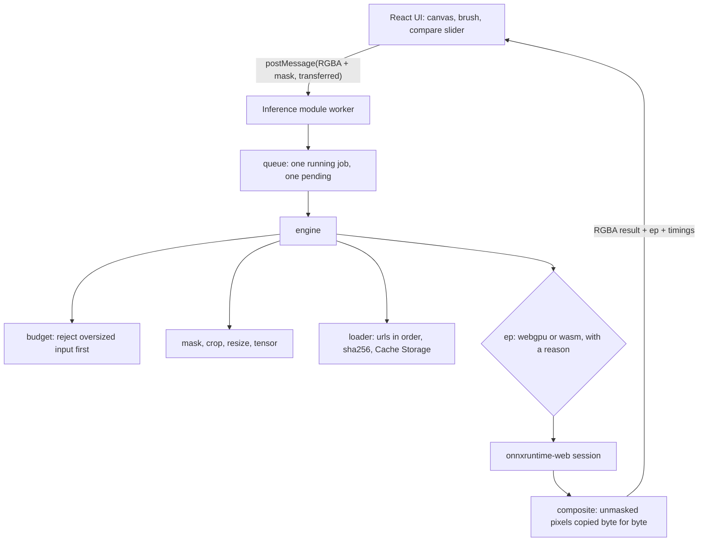

# 🪄 Inpaint Web

> In-browser object removal. Paint over an object and a 29 MB model fills it in, entirely on your device.

**Remove objects from photos in your browser, 38x faster on WebGPU than WASM, zero uploads.**

<!-- readme-header -->
[](https://github.com/sathwikbairaboina2/inpaint-web/actions/workflows/ci.yml)    

| Measured | Source |
|---|---|
| **38.9× WebGPU vs WASM** (median of 5 rounds) | `bench/results/latest.json` |

Paint over something you want gone and the model fills it in. It runs in your tab with onnxruntime-web: WebGPU when the
device has it, multi-threaded WASM when it does not. Photos never leave the page. After the first visit it works offline.

| Before | After |
|---|---|
|  |  |

The gold foil at the right edge was painted over and removed. Screenshot of the editor with the compare slider:
[docs/media/ui.png](docs/media/ui.png).

## 30-second quickstart

```bash
pnpm install
pnpm models:fetch          # 29.5 MB, sha256 verified
pnpm dev                   # http://localhost:5420/?sample=1
```

Or with Docker (nginx with the cross-origin isolation headers):

```bash
docker compose up -d app   # http://localhost:5422
docker compose down
```

Click "Try sample photo", brush over something, press "Remove object". Drag the slider to compare, then download the PNG.

## Measured result

Quoted from [`bench/results/latest.json`](bench/results/latest.json) by `node scripts/bench-table.mjs` (rounded to 0.1 ms).
Reproduce with `pnpm bench`.

| EP | Threads | Device | Run median (ms) | Run p90 (ms) | Session create (ms) |
|---|---|---|---|---|---|
| webgpu | 1 | nvidia lovelace | 39.7 | 61.2 | 869.4 |
| wasm | 16 | AMD Ryzen 9 7900X 12-Core Processor | 1543.3 | 1704.2 | 357.2 |

Speedup: 38.91x, the median of 5 per-round speedups (19.16, 41.03, 13.27, 38.91, 39.84); the row values above are that round. Each round runs webgpu and wasm back to back. 20 timed runs per EP per round after 1 warm-up, 512x512 image, 128x128 hole.
Chrome 154.0.8037.97, commit fe495ab (dirty: false), 2026-10-04.

Read this with care. It is one machine (an RTX 4090 class GPU, adapter reported as "nvidia lovelace") in headless Chrome.
The host was busy with other builds during the run, which is why the per-round speedups spread from 13x to 41x; the
headline is their median, so one noisy round cannot set it (all rounds are in the same file). "Run" is the model call plus output readback, not the whole
job. Phones will be much slower. The method is in [ADR 0008](docs/adr/0008-benchmark-method.md).

## How it works



The pure core (`src/core`) takes an injected onnxruntime handle, so the same pipeline runs in Node tests (a fake model, or
the real MI-GAN through onnxruntime-node) and in the browser.

## Guarantees and the tests that prove them

| Invariant | Test |
|---|---|
| Pixels outside your mask are byte-identical to the input | `tests/composite.test.ts` (property test), `tests/engine.test.ts`, `tests/golden.test.ts` (real MI-GAN), `e2e/inpaint-preserve.spec.ts` (real app) |
| Over 4096 px on the long side or over 16,777,216 pixels is rejected before any allocation | `tests/budget.test.ts`, `tests/engine.test.ts` (no tensor, no model load) |
| A model whose sha256 does not match is never executed | `tests/loader.test.ts`, `tests/engine.test.ts` (no session created) |
| No WebGPU, or a WebGPU failure, falls back to WASM and reports why | `tests/ep.test.ts`, `e2e/fallback.spec.ts` |
| One job runs at a time; a new job replaces only the pending one | `tests/queue.test.ts`, `tests/handler.test.ts` |
| Works offline after the first visit, no model request | `e2e/offline.spec.ts` |
| Inference does not block the main thread (no task over 100 ms during a job) | `e2e/responsiveness.spec.ts` |
| The crop always contains the mask and stays inside the image | `tests/crop.test.ts` (property test) |

## Install as an app, or as a library

- App: open the site in Chrome or Edge and use "Install". The service worker caches the shell and the ORT runtime. The
  model is cached in Cache Storage after the first run.
- Library: `src/core` builds on its own (`pnpm build:lib`, then `npm pack --dry-run` shows the tarball). The package is
  pack-verified, not publish-ready: `package.json` is the app's (`inpaint-web`, `private`, with React among its dependencies),
  so a real release needs its own manifest named `@sathwik/browser-img-ops` with `onnxruntime-web` as an optional peer
  dependency.
  Exports: `createEngine`, `loadModel`, `selectProvider`, `compositeMasked`, `planCrop`, `checkImageBudget` and more.

## Known limits

- MI-GAN is a 512 px model. A very large hole in a large photo comes out soft. LaMa handles big holes better but is 7x
  larger ([ADR 0002](docs/adr/0002-migan-not-lama.md)).
- The headline is one machine. The WebGPU path was only measured on the host GPU.
- Container and CI end-to-end runs cover the WASM path only (their Chromium has no WebGPU).
- No upscale in v0.1 ([ADR 0003](docs/adr/0003-upscale-deferred.md)).
- Not deployed anywhere yet. The 29.5 MB model is over Cloudflare Pages' 25 MiB per-file limit, which is why the manifest
  falls back to the pinned Hugging Face URL.

## What's next

Upscale with a self-exported Real-ESRGAN, LaMa as a high-quality option, npm publish, a public deploy, fp16 and WebNN.

## Develop

```bash
pnpm typecheck && pnpm test      # unit, property and golden tests
pnpm e2e                         # Playwright against vite preview on :5421
pnpm build                       # dist/ with dist/ort, dist/sw.js, dist/bench.html
pnpm bench                       # 5 rounds by default, writes bench/results/latest.json
```

See [docs/DEVDOCS.md](docs/DEVDOCS.md) for the full developer guide, [MODELS.md](MODELS.md) for model licenses and hashes,
and `docs/adr/` for the decisions. MIT licensed.
