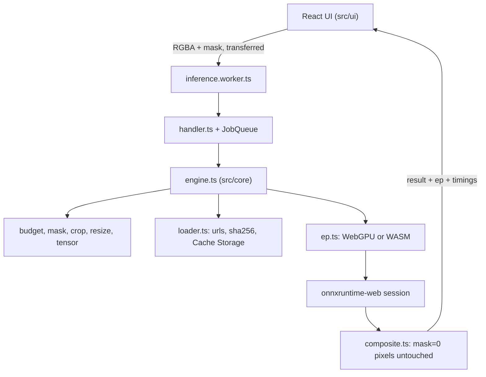

# Inpaint Web developer guide

## 1. What it is

A browser tool that removes objects from photos. You paint over the object and a small model (MI-GAN, 29.5 MB) fills the
hole. It runs on your device with onnxruntime-web, on WebGPU when available and on threaded WASM otherwise. Nothing is
uploaded.

Headline number, from `bench/results/latest.json` (commit 3d2db99, Chrome 154, one machine, loaded host): the model run is
**43.53x faster on WebGPU than on WASM** (50.2 ms against 2184.4 ms median, 20 runs, 512x512 image, 128x128 hole).

## 2. Five-minute quickstart

Needs Node 24 and pnpm 9.12.0.

```bash
pnpm install
pnpm models:fetch      # downloads public/models/migan.onnx and checks its sha256
pnpm dev               # http://localhost:5420/?sample=1
```

Press "Remove object" after painting. `?ep=wasm` forces the WASM path. Docker: `docker compose up -d app` serves the built
site on http://localhost:5422 through nginx.

## 3. Architecture



The core never imports onnxruntime. The engine receives an `OrtLike` object, so Node tests use a fake model and the golden
test uses onnxruntime-node. The worker wires in onnxruntime-web, `fetch`, Cache Storage and `navigator.gpu`.

Job flow: check the size budget, find the mask bounding box, plan a square crop with a margin, resize it to 512x512, run the
model, resize the patch back, then copy only masked pixels (with a 2 px inward feather) onto the original.

## 4. Project layout

| Path | What lives there |
|---|---|
| `src/core/` | Pure TypeScript pipeline: budget, mask, crop, resize, tensor, composite, loader, ep, queue, stroke, stats, engine |
| `src/worker/` | Message protocol, handler (Node-tested), browser wiring, the module worker, the client |
| `src/ui/` | React editor: drop zone, brush canvas, compare slider, device badge, progress |
| `src/bench/`, `bench/` | Bench page and the runner that writes `bench/results/*.json` |
| `vite/ort-assets.ts` | Serves and emits the ORT glue at `/ort/` with COOP/COEP headers ([ADR 0004](adr/0004-ort-asset-serving.md)) |
| `public/models/manifest.json` | Pinned model URLs, sha256, IO convention. The `.onnx` is git-ignored |
| `scripts/` | `models-fetch.mjs`, `sample-fetch.mjs`, `demo-shots.ts`, `bench-table.mjs` |
| `tests/` | Vitest unit, property and golden tests; `tests/helpers/` has the fake ORT and fake fetch |
| `e2e/` | Playwright specs against the real app and real model |
| `Dockerfile`, `deploy/nginx.conf`, `docker-compose.yml` | Image with isolation headers; `e2e` profile runs Playwright in a container |
| `.github/workflows/ci.yml` | Typecheck, tests, build, lib pack, e2e |
| `docs/adr/` | Decisions 0001 to 0009 |

## 5. Run, test and benchmark

| Command | What it does |
|---|---|
| `pnpm dev` | Vite dev server on :5420 |
| `pnpm typecheck` | `tsc --noEmit` over src, tests, e2e, bench, scripts |
| `pnpm test` | All Vitest files. The golden MI-GAN test runs only after `pnpm models:fetch` |
| `UPDATE_GOLDEN=1 pnpm test tests/golden.test.ts` | Regenerates `tests/golden/migan-synthetic.png` |
| `pnpm build` | Typecheck, then `vite build` into `dist/` (includes `dist/ort`, `dist/sw.js`, `dist/bench.html`) |
| `pnpm e2e` | Builds, starts `vite preview` on :5421 and runs Playwright with the installed Chrome |
| `pnpm build:lib && npm pack --dry-run` | Library build of `src/core` and the tarball listing |
| `docker compose build app && docker compose --profile e2e run --rm e2e && docker compose down` | Container e2e on the WASM path |
| `pnpm bench` | Builds, runs the benchmark in headless Chrome, writes `bench/results/latest.json` |
| `node scripts/bench-table.mjs` | Prints the README results table from the JSON |

Run `pnpm bench` on a clean tree and with the machine idle; the result records `dirty` and the git sha.

## 6. Key decisions and what they gave up

| Decision | Gave up | ADR |
|---|---|---|
| MI-GAN 512 instead of LaMa | Quality on very large holes | [0002](adr/0002-migan-not-lama.md) |
| Upscale deferred to v0.2 | A second wow feature in v0.1 | [0003](adr/0003-upscale-deferred.md) |
| ORT glue served from `/ort/` by a Vite plugin | Depends on ORT internal file names | [0004](adr/0004-ort-asset-serving.md) |
| RGBA buffers in the worker protocol, deterministic compositor | Slightly harder edges (inward feather only) | [0005](adr/0005-deterministic-core.md) |
| Pinned model with sha256 and Hugging Face fallback | A first-run download of 29.5 MB | [0006](adr/0006-model-delivery.md) |
| Host Node for dev and bench, Docker for the image and container e2e | Not Docker-only; WebGPU only measured on host | [0007](adr/0007-toolchain-and-ports.md) |
| Median of the model run as the headline | Noise on a shared host | [0008](adr/0008-benchmark-method.md) |
| PWA shell and a separately buildable core | Larger precache (the ORT wasm is 26 MB) | [0009](adr/0009-pwa-and-library.md) |

Two build-time rulings are in the ledger and the handoff: the loader tries the next URL on a hash mismatch, and the
container e2e shares the app's network so the page is on `localhost` (a secure context).

## 7. Known limits and what is left

- One machine's numbers; the WASM spread is wide on a busy host.
- Container and CI e2e do not exercise WebGPU.
- The 100 ms long-task check covers the job window; painting the result in a software-rendered container can exceed it
  once and is only reported.
- Not published or deployed (no remotes in this session). Upscale, LaMa option, npm publish (needs its own library manifest, the root one is the app's), deploy, fp16 and WebNN are next.
