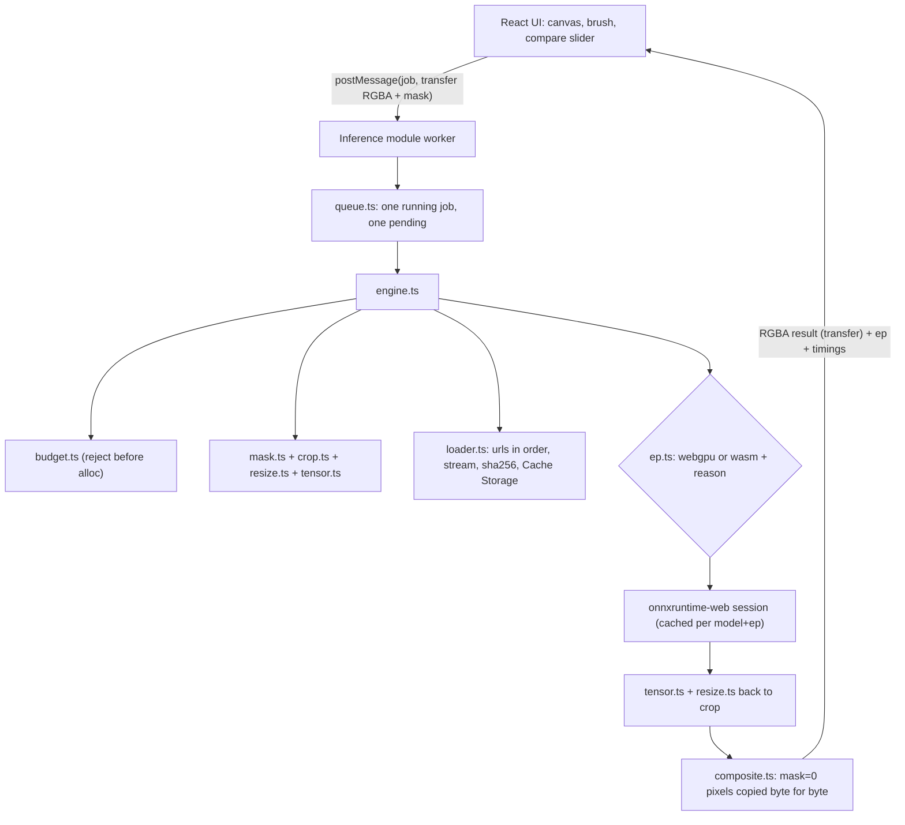

# inpaint-web v0.1 spec (2026-10-04)

Lead: Claude Opus (plan, review). Builder: `sonnet-builder`. Design input: `C:\Users\sathwik\projects\taskarinchu\docs\devdocs\inpaint-web.md`.
Plan: `docs/superpowers/plans/2026-10-04-inpaint-web.md`. Decisions: `docs/adr/0001`-`0009`.

## One line

Remove objects from photos in the browser tab with onnxruntime-web: WebGPU when the device has it, threaded WASM when it
does not, a deterministic core that guarantees unmasked pixels never change, and zero uploads.

README first line format (N filled from `bench/results/latest.json`, never typed by hand):
"Remove objects from photos in your browser, Nx faster on WebGPU than WASM, zero uploads."

## Portfolio bar (from the shortlist) and how v0.1 meets it

| Bar | v0.1 answer |
|---|---|
| 30-second wow | Open the page, click "Try sample" (public-domain Apollo 11 photo), brush over something, click "Remove object". Works on a phone through the WASM path. README hero is a before/after image pair captured by Playwright from the real app. |
| Measured headline number | `pnpm bench` drives headless host Chrome (WebGPU on the host GPU) and writes `bench/results/latest.json` with the WebGPU vs WASM speedup of the MI-GAN run phase. README quotes it. |
| Something installable | (a) The app is an installable PWA that works offline after the first visit. (b) `src/core` builds as a library (`pnpm build:lib`) and `npm pack --dry-run` passes, ready to publish as `@sathwik/browser-img-ops` (not published: no push in this session). |
| Honest ADRs | `docs/adr/0001`-`0009`, each with "what we gave up". |
| CI with tests | `.github/workflows/ci.yml`: typecheck, unit + property tests, golden-model test (onnxruntime-node), build, Playwright e2e on the WASM path. |

## Scope

In v0.1:
- Inpaint (object removal) with MI-GAN 512 (`migan.onnx`, MIT, 29,546,882 bytes, sha256 `593eba0b...c5ae`). ADR 0002.
- Execution provider selection: WebGPU first, WASM fallback with reason. "Force WASM" toggle and `?ep=wasm` URL param.
- Deterministic core: budget, mask ops, crop planning, resize, tensor conversion, compositing, single-job queue.
- Model loader: ordered URL list (same-origin mirror, then pinned Hugging Face revision), streaming progress, sha256 verify,
  Cache Storage, stale-version eviction. ADR 0006.
- Inference in a dedicated module Web Worker.
- Editor UI: drop / paste / file picker / "Try sample", brush + eraser + size + undo + clear, Remove object, progress,
  before/after slider, Download PNG, device badge.
- PWA offline shell (vite-plugin-pwa). ADR 0009.
- Bench page + runner + committed measured results.
- Docker image (nginx with COOP/COEP) and compose e2e on container Chromium (WASM path).
- CI workflow, README, MODELS.md, DEVDOCS, handoff.

Out of v0.1 (v0.2 backlog, recorded in ADR 0003 and the README "What's next"):
- 4x upscale (Real-ESRGAN) and `core/tiling.ts` (design invariants 3 and 4). Reason: the only ready ONNX export found is in
  a GPL-3.0 repo (`lxfater/inpaint-web`), and `qualcomm/Real-ESRGAN-*` ONNX URLs return 404. Needs our own export.
- LaMa as a "high quality" model option (ADR 0002 has the measurements).
- Publishing the npm package, Cloudflare/Netlify deploy (no remotes or accounts in this session), fp16, WebNN.

## Prototype findings (2026-10-04, scratch prototype, not README numbers)

All in headless host Chrome 154 via Playwright `channel: 'chrome'`, `--enable-unsafe-webgpu`, host GPU NVIDIA GeForce
RTX 4090 (nvidia-smi), `crossOriginIsolated: true`, `hardwareConcurrency: 24`, `onnxruntime-web@1.30.0`, 512x512 input.
The host was loaded by other concurrent builds, so WASM numbers were noisy (median moved between 298 ms and 3261 ms).

| Model | File | EP | Session create | Run median (n) |
|---|---|---|---|---|
| MI-GAN `migan.onnx` | 29.5 MB | webgpu | 0.9-2.6 s | 26-48 ms (3-10) |
| MI-GAN `migan.onnx` | 29.5 MB | wasm 16 threads | 0.2-1.0 s | 298-3261 ms (3-10) |
| LaMa `lama_fp32.onnx` (Carve) | 208 MB | webgpu | 32.1 s | 169 ms (3) |
| LaMa `lama_fp32.onnx` (Carve) | 208 MB | wasm 16 threads | 7.6 s | 3181 ms (3) |

Other verified facts the plan relies on:
1. **MI-GAN IO.** `migan.onnx` inputs `image` uint8 `[1,3,H,W]` RGB and `mask` uint8 `[1,1,H,W]`; output `result` uint8
   `[1,3,H,W]`. Mask convention: **255 = keep, 0 = hole** (with 0 = hole the masked region changed by mean 51 levels and the
   rest by 0; the inverse convention changed the wrong region). The model already copies known pixels through, but our
   compositor still owns invariant 1 because resizing back to the crop changes pixels.
2. **onnxruntime-node 1.30.0** runs `migan.onnx` on CPU in ~0.6 s; its output differs slightly from browser WASM
   (sampled checksum 100251 vs 100357), so cross-runtime goldens use PSNR, never byte equality.
3. **ORT + Vite production build crash.** Importing `onnxruntime-web/webgpu` (default "bundle" entry) works in `vite dev`,
   but in `vite build` + `vite preview` with `numThreads > 1` the renderer crashes ("Target crashed"); `numThreads = 1` works.
   Fix that works in dev and build: Vite `resolve.conditions: ['onnxruntime-web-use-extern-wasm']`, `ort.env.wasm.wasmPaths = '/ort/'`,
   and a small Vite plugin that serves `ort-wasm-simd-threaded.asyncify.{mjs,wasm}` from `node_modules/onnxruntime-web/dist/`
   at `/ort/` in dev (with COOP/COEP headers on those responses; without them dev also crashed) and emits them to `dist/ort/`
   on build. Files under `public/` cannot be used: Vite refuses dynamic imports of `public/` files in dev. ADR 0004.
4. **Container Chromium** (`mcr.microsoft.com/playwright:v1.63.0-noble`, Chromium 153) against nginx on a compose network:
   WebGPU absent (`navigator.gpu` undefined, ORT error "WebGPU is not supported in current environment"), WASM works.
   `crossOriginIsolated` is false there because `http://<service>:port` is not a secure context, so WASM is single-threaded.
   Ruling: container/CI e2e cover the WASM path only; WebGPU is measured on the host.
5. **Hugging Face** serves `https://huggingface.co/andraniksargsyan/migan/resolve/406830d0fa60666da0071c342ad2fbc8f30c5c64/migan.onnx`
   (302 to a CDN, then 200, `access-control-allow-origin: *`), so a COEP `require-corp` page can `fetch()` it in CORS mode.
   GitHub `Picsart-AI-Research/MI-GAN` license: MIT. HF model card license: MIT.
6. **Sample image.** `https://upload.wikimedia.org/wikipedia/commons/thumb/9/98/Aldrin_Apollo_11_original.jpg/960px-Aldrin_Apollo_11_original.jpg`,
   960x966 JPEG, 280,403 bytes, sha256 `7ea66a1e0632c564bd1beb4733abe5ef26d70de0561d5fd000b8f7bb92e6bd38` (stable across two
   downloads), Wikimedia Commons license "Public domain" (NASA AS11-40-5903). Send a `User-Agent` header when downloading.

## Architecture



The UI thread decodes the image once into RGBA (`createImageBitmap(file, { colorSpaceConversion: 'none', premultiplyAlpha: 'none' })`,
then a canvas `getImageData`). Worker messages carry RGBA `ArrayBuffer`s, not `ImageBitmap`s, so pixels are compared exactly
and the core runs unchanged in Node tests. The design doc's ImageBitmap transport is replaced on purpose (ruling in ADR 0005).

## Core contracts (all pure TypeScript under `src/core/`, Node-testable)

```ts
// types.ts
export type RGBAImage = { data: Uint8ClampedArray; width: number; height: number }
export type Mask = { data: Uint8Array; width: number; height: number }       // 1 = remove, 0 = keep
export type Rect = { x: number; y: number; w: number; h: number }
export type EpName = 'webgpu' | 'wasm'
export type ErrorCode = 'TOO_LARGE' | 'EMPTY_MASK' | 'BAD_INPUT' | 'HASH_MISMATCH' | 'DOWNLOAD_FAILED'
  | 'UNSUPPORTED' | 'OOM' | 'CANCELLED' | 'INTERNAL'
export class InpaintError extends Error { constructor(public code: ErrorCode, message: string) }
export type Phase = 'download' | 'session' | 'pre' | 'run' | 'post'
export type Progress = { phase: Phase; done: number; total: number }
export type Timings = { loadMs: number; sessionMs: number; preMs: number; runMs: number; postMs: number; totalMs: number }
```

| Module | Exports | Rules |
|---|---|---|
| `manifest.ts` | `parseManifest(json: unknown): Manifest`, `getModel(m, id)` | Throws `InpaintError('BAD_INPUT')` on a missing field, a non-64-hex sha256, an empty `urls`, a `size` not a positive multiple of 8, or `version !== 1`. |
| `budget.ts` | `MAX_SIDE = 4096`, `MAX_PIXELS = 16_777_216`, `checkImageBudget(w, h)` | Throws `TOO_LARGE` when `max(w,h) > 4096` or `w*h > 16_777_216`; `BAD_INPUT` when `w` or `h` is < 1 or not an integer. |
| `mask.ts` | `maskBBox(mask): Rect \| null`, `dilateMask(mask, r): Mask`, `cropMask(mask, rect)`, `resizeMaskAny(mask, w, h): Mask` | `resizeMaskAny` marks a target pixel 1 if any source pixel in its footprint is 1 (thin strokes survive downscale). `dilateMask` uses a square (Chebyshev) radius. |
| `crop.ts` | `planCrop(bbox, imgW, imgH, opts?: { margin = 64, minSide = 256 }): Rect` | Side `S = max(max(bbox.w, bbox.h) + 2*margin, minSide)`; square of side S centred on the bbox, shifted to lie inside the image; each dimension clamped to the image size if S exceeds it. Result always contains the bbox and lies inside the image. |
| `resize.ts` | `cropRGBA(img, rect)`, `resizeBilinear(img, w, h): RGBAImage` | Same-size resize returns an equal copy; a constant image stays constant; output dims exact. Alpha is resized like the colour channels. |
| `tensor.ts` | `rgbaToNCHW(img, dtype: 'uint8' \| 'float32', scale)`, `nchwToRGBA(data, w, h, scale, alphaFrom?)`, `maskToNCHW(mask, dtype, keep, hole)` | RGB only (alpha dropped going in; alpha taken from `alphaFrom` or 255 coming out); float output clamped to [0,255] and rounded. |
| `composite.ts` | `compositeMasked(original, patch, rect, mask, opts?: { feather = 0 }): RGBAImage` | Output starts as a byte copy of `original`. Only pixels with `mask = 1` inside `rect` are written. With `feather > 0`, a masked pixel at Chebyshev distance `d` (1..feather) from the nearest unmasked pixel gets `alpha = d / (feather + 1)` of the patch; deeper pixels get the patch fully. **Alpha channel always copied from the original.** So every `mask = 0` pixel is byte-identical (invariant 1), regardless of feather. |
| `hash.ts` | `sha256Hex(bytes): Promise<string>` | `crypto.subtle.digest('SHA-256')` (global in browsers and Node 24). |
| `loader.ts` | `loadModel(model, deps: { fetch, cache: ModelCache, onProgress? }): Promise<Uint8Array>` | Cache key `models/<id>/<sha256>`. Cached bytes are re-hashed; a mismatch deletes the entry and refetches once. Network: try `model.urls` in order (non-2xx or throw → next URL); stream with `download` progress (`total` = `bytes` from the manifest when `content-length` is absent); hash; mismatch → `HASH_MISMATCH` (nothing cached, nothing returned); all URLs fail → `DOWNLOAD_FAILED`. After a good fetch: put, then delete other keys under `models/<id>/`. |
| `ep.ts` | `wasmThreads(coi, hc)`, `selectProvider({ gpu, forceWasm, createSession })` | `wasmThreads = coi ? clamp(hc, 1, 16) : 1`. Order: `forceWasm` → reason `forced`; `gpu` undefined → `no-webgpu-api`; `requestAdapter()` null or rejects → `no-adapter`; `limits.maxBufferSize < model.minBufferBytes` → `limits`; webgpu session create throws → `session-error: <message>`. Each fallback creates a wasm session and returns `{ ep: 'wasm', session, reason }`; success returns `{ ep: 'webgpu', session }`. A wasm create failure throws `UNSUPPORTED`. |
| `queue.ts` | `class JobQueue<T, R>` with `submit(id, job): Promise<R>` | One running job at a time. At most one pending: a new submit while a job is pending rejects the pending one with `CANCELLED` and takes its place. The running job is never cancelled (invariant 7). |
| `stroke.ts` | `paintStroke(mask, from, to, radius, value)` | Stamps discs along the segment (step <= radius/2), writes `value` (1 brush, 0 eraser); pure, used by the UI. |
| `stats.ts` | `median(xs)`, `percentile(xs, p)` (nearest-rank), `summarize(xs)` | Used by the bench. |
| `engine.ts` | `createEngine(deps): Engine` | See below. |
| `index.ts` | Re-exports the public library surface. | |

**Engine.** `createEngine({ ort, manifest, modelId = 'migan-512', loadModel, gpu, crossOriginIsolated, hardwareConcurrency, now })`.
`engine.inpaint(image: RGBAImage, mask: Mask, opts: { forceWasm?, onProgress?, feather? = 2 })` runs:
1. `checkImageBudget` (before any allocation; a test proves no tensor is constructed on `TOO_LARGE`), mask dims must equal
   image dims (`BAD_INPUT`), `maskBBox` null → `EMPTY_MASK`.
2. Load bytes (cached in memory after the first load), create or reuse the session for `(modelId, ep)` via `selectProvider`
   (`ort.env.wasm.numThreads = wasmThreads(...)` set before the first create).
3. Pre: `planCrop` → `cropRGBA` + `resizeBilinear(size, size)`; mask: `cropMask` → `resizeMaskAny(size, size)` →
   `dilateMask(r = 3)` → `maskToNCHW(keep 255, hole 0)`.
4. Run: `session.run({ [io.inputs.image]: ..., [io.inputs.mask]: ... })`, read `io.output` with `await tensor.getData()`.
5. Post: `nchwToRGBA` → `resizeBilinear(rect.w, rect.h)` → `compositeMasked(original, patch, rect, fullMask, { feather })`.
6. Return `{ image, ep, fallbackReason?, timings }`. A thrown error whose message matches `/out of memory|allocation/i`
   becomes `OOM`; other non-`InpaintError` errors become `INTERNAL`.

`engine.dispose()` releases sessions.

## Model manifest (`public/models/manifest.json`, committed)

```json
{
  "version": 1,
  "models": [{
    "id": "migan-512",
    "task": "inpaint",
    "file": "migan.onnx",
    "urls": [
      "/models/migan.onnx",
      "https://huggingface.co/andraniksargsyan/migan/resolve/406830d0fa60666da0071c342ad2fbc8f30c5c64/migan.onnx"
    ],
    "sha256": "593eba0b7e04730f1b61c0a3cbca68d97d8d6a7ff5c6a44a7b9d7fcd880fc5ae",
    "bytes": 29546882,
    "size": 512,
    "minBufferBytes": 268435456,
    "io": { "dtype": "uint8", "imageScale": 1, "outputScale": 1, "maskKeep": 255, "maskHole": 0,
            "inputs": { "image": "image", "mask": "mask" }, "output": "result" },
    "license": "MIT",
    "source": "https://github.com/Picsart-AI-Research/MI-GAN",
    "weights": "https://huggingface.co/andraniksargsyan/migan"
  }]
}
```

`public/models/*.onnx` is git-ignored; `pnpm models:fetch` downloads it from the HF URL and verifies the sha256.

## Worker protocol (`src/worker/protocol.ts`)

```ts
type JobRequest = { kind: 'inpaint'; jobId: string; width: number; height: number;
  rgba: ArrayBuffer; mask: ArrayBuffer; forceWasm: boolean }            // both buffers transferred
type JobEvent =
  | { kind: 'progress'; jobId: string; phase: Phase; done: number; total: number }
  | { kind: 'result'; jobId: string; width: number; height: number; rgba: ArrayBuffer; ep: EpName;
      fallbackReason?: string; timings: Timings }                        // rgba transferred
  | { kind: 'error'; jobId: string; code: ErrorCode; message: string }
  | { kind: 'device'; webgpu: boolean; adapter?: string; threads: number; crossOriginIsolated: boolean }
```

`src/worker/handler.ts` exports `createHandler(engine, post)` (pure, Node-tested with a fake engine); the worker file only wires
`self.onmessage` and the browser deps (Cache Storage cache `inpaint-web-models`, `fetch`, `navigator.gpu`).

## UI

React 19, one page (`index.html`), plus `bench.html`. Elements and test ids the e2e tests rely on:
`data-testid` = `drop-zone`, `file-input`, `sample-button`, `mask-canvas`, `brush-size`, `tool-brush`, `tool-eraser`,
`undo`, `clear-mask`, `remove-button`, `progress`, `compare-slider`, `download`, `device-badge`, `force-wasm`, `error`.
URL params: `?ep=wasm` forces WASM; `?sample=1` loads the sample on start.
Test hook (always on, harmless): `window.__inpaint = { setMask(rects: Rect[]), run(): Promise<{ ep, timings }>,
getOriginal(): RGBAImage, getResult(): RGBAImage | null }` so e2e can draw an exact mask and compare pixels.
Visual direction: load the `minimalist-ui` skill before UI tasks (warm monochrome, one accent, no gradients); must work at
360 px width with touch (pointer events) and keyboard (all buttons reachable, slider operable with arrow keys).

## Invariants and their proving tests

| # | Invariant | Test |
|---|---|---|
| 1 | Pixels with mask = 0 are byte-identical to the input. | `tests/composite.test.ts` (fast-check: random image, mask, rect, patch noise, feather 0..4), `tests/engine.test.ts` (fake model returning noise), `tests/golden.test.ts` (real MI-GAN in onnxruntime-node), `e2e/inpaint-preserve.spec.ts` (real app, WASM) |
| 2 | > 4096 px long side or > 16,777,216 px is rejected with `TOO_LARGE` before any allocation. | `tests/budget.test.ts` (4096/4097 boundaries, 4096x4096 ok), `tests/engine.test.ts` (spy: `ort.Tensor` and `loadModel` never called) |
| 3 | A model whose bytes do not match sha256 is never executed. | `tests/loader.test.ts` (tampered bytes → `HASH_MISMATCH`, nothing cached), `tests/engine.test.ts` (`InferenceSession.create` never called) |
| 4 | WebGPU unavailable or failing → the job completes on WASM and the reason is reported. | `tests/ep.test.ts` (5 cases), `e2e/fallback.spec.ts` (`?ep=wasm` → badge shows WASM, job completes) |
| 5 | One job runs at a time; a new job cancels the pending one, never the running one. | `tests/queue.test.ts` |
| 6 | No network requests during inference once cached; app works offline after first visit. | `e2e/offline.spec.ts` |
| 7 | Inference never blocks the main thread. | `e2e/responsiveness.spec.ts` (PerformanceObserver `longtask`: no task > 100 ms while a job runs) |
| 8 | Crop always contains the mask bbox and lies inside the image. | `tests/crop.test.ts` (fast-check) |

## Benchmark method (ADR 0008)

`bench.html?runs=20` runs the real engine in the real worker on a fixed synthetic 512x512 image (deterministic pattern) with
a fixed 128x128 square mask, for `webgpu` then `wasm`, each with a fresh session: 1 warm-up + `runs` timed jobs. It records
per EP `sessionMs` and `summarize()` of `runMs` (session.run + output readback) and `totalMs` (whole job). `bench/run.ts`
starts `vite preview` (port 5421), launches Playwright `chromium` with `channel: 'chrome'`, `headless: true`,
`args: ['--enable-unsafe-webgpu']`, reads the result object, adds machine info (`navigator.userAgent`, adapter
`info.vendor/architecture/description`, `hardwareConcurrency`, wasm threads, `crossOriginIsolated`, date, git sha), computes
`speedup = wasm.run.median / webgpu.run.median` (2 decimals), writes `bench/results/latest.json` and appends a copy as
`bench/results/<ISO date>-<sha>.json`. If WebGPU is unavailable it writes the WASM numbers with `webgpu: null` and
`speedup: null` and exits 2. README and DEVDOCS quote only these files.

## Ports, names, toolchain (ADR 0007)

- Host Node v24.18.0, pnpm 9.12.0 (`packageManager` field). Own `node_modules` in this repo.
- Ports: dev 5420, preview 5421, Docker app 5422. Nothing else.
- Docker: `Dockerfile` (`node:24-alpine` build → `nginx:1.29-alpine`), compose project name `inpaint-web`,
  container names `inpaint-web-app`, `inpaint-web-e2e`; e2e image `mcr.microsoft.com/playwright:v1.63.0-noble`.

## Pinned dependencies (verified on npm 2026-10-04)

Runtime: `onnxruntime-web 1.30.0`, `react 19.3.0`, `react-dom 19.3.0`, `workbox-window 7.4.1`.
Dev: `vite 8.3.2`, `@vitejs/plugin-react 6.1.1`, `vite-plugin-pwa 1.3.0` (peer vite ^8; 2.0.0 exists but 1.3.0 is proven
with vite 8 in the sibling co-author repo), `vitest 5.0.3`, `typescript 7.0.2`, `@playwright/test 1.63.0`, `fast-check 4.10.2`,
`onnxruntime-node 1.30.0`, `pngjs 7.0.0`, `@types/pngjs 6.0.5`, `@types/react 19.3.0`, `@types/react-dom 19.3.0`,
`@types/node 26.6.4`, `@webgpu/types 0.1.74`, `tsx 4.23.15`. Exact versions (no `^`).

## Known limits (honest)

- MI-GAN is a 512-px model: very large holes on large photos blur. LaMa is better on big holes but 7x larger (ADR 0002).
- WebGPU numbers come from one machine (RTX 4090, Chrome 154); phones will be far slower. The README says which machine.
- No upscale in v0.1.
- Not deployed publicly in this session (no accounts/remotes). `Dockerfile` + `deploy/nginx.conf` + `public/_headers`
  are ready for Netlify/Cloudflare-style hosts; the 29.5 MB model exceeds Cloudflare Pages' 25 MiB per-file limit, which is
  why the manifest falls back to the pinned Hugging Face URL.
